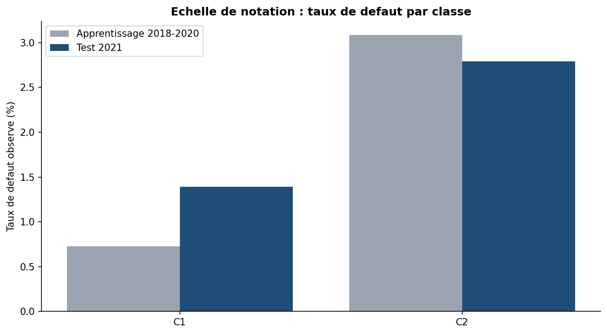

# Score de crédit pour une clientèle de particuliers

Ce projet construit une grille de score qui estime la probabilité de défaut à 12 mois d'un client, à partir de ses données de crédit, de compte et de profil. Il porte sur 5 752 observations de 2 289 clients, sur quatre dates d'observation (2018 à 2021). Projet réalisé à l'ESSAI.

**Défaut** : plus de 90 jours de retard de paiement dans les 12 mois.

## Démarche

1. **Validation hors période** : apprentissage sur 2018-2020, test sur 2021. La validation croisée est **groupée par client**, car un même client apparaît à plusieurs dates.
2. **Préparation** : variables à risque de fuite retirées (code tribunal), ratios d'endettement, âge à la date d'observation.
3. **Encodage WoE** appris sur l'apprentissage, avec des classes fusionnées pour que le taux de défaut varie dans un seul sens.
4. **Sélection** en trois étapes : Information Value (entre 0,02 et 0,5), stabilité dans le temps (PSI inférieur à 0,1), puis stepwise sur l'AUC.
5. **Régression logistique réglée**, sans rééquilibrage, pour garder des PD calibrées. Elle est comparée à un **modèle challenger** (gradient boosting).
6. **Grille de points** (600 points pour une cote de 50:1, 20 points pour doubler la cote) et **échelle de notation**, construites sur l'apprentissage puis vérifiées sur 2021.

## Résultats

| Modèle | AUC CV 2018-2020 | AUC 2021 | PD prédite / observée en 2021 |
|---|---|---|---|
| Grille de score initiale | 0,75 | 0,58 | 3,6 % / 2,2 % |
| **Grille révisée (variables stables)** | 0,70 | **0,64** | **2,0 % / 2,2 %** |
| Challenger gradient boosting | 0,74 | 0,80 | 1,4 % / 2,2 % |

- **Le test 2021 a révélé une rupture de données.** Le ratio encours sur engagement change complètement de distribution (PSI de 1,72), alors que rien ne le laissait voir dans les années d'apprentissage. La grille révisée le retire et reste calibrée.
- **Effet du COVID :** sans l'année 2020 (reports d'échéances imposés par la BCT), le score varie à peine.
- **Le challenger discrimine mieux,** mais il est moins lisible. En banque, il servirait à surveiller la grille.

## Données

La base concerne de vrais clients : elle n'est **pas publiée**, et le notebook n'affiche que des résultats agrégés. Le fichier `data/echantillon_fictif.csv` contient 100 lignes fictives avec les mêmes colonnes, pour montrer la structure des données. Il ne correspond à aucun client réel.

Technologies : Python, pandas, scikit-learn.
